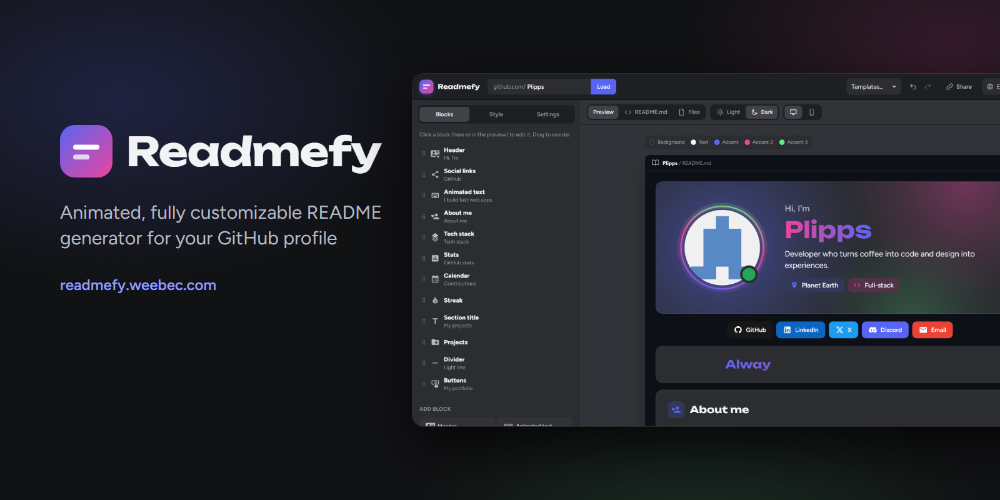

# Readmefy



<p align="center">
  <a href="https://readmefy.weebec.com"></a>
  <a href="https://buymeacoffee.com/plipps"></a>
</p>

Animated, fully customizable README generator for your GitHub profile, with a modern Discord-inspired style: blurple, fuchsia and green on rounded grey cards, soft colour glows, a name with an animated gradient, a gradient ring around the avatar and a status indicator (online, idle, do not disturb, offline).

Each block is generated as an **animated SVG** (CSS and SMIL animations) with the fonts and the avatar embedded, so it looks the same on GitHub, which does not allow CSS or JavaScript in READMEs. There are light and dark versions that follow the GitHub theme (`<picture>` + `prefers-color-scheme`).

## Usage

The live version is available at [readmefy.weebec.com](https://readmefy.weebec.com).

It is a static website with no dependencies and no build step. Because it uses ES modules, it must be served over HTTP (opening `index.html` directly from disk does not work):

```bash
git clone https://github.com/Plipps45/Readmefy.git
cd Readmefy
python -m http.server 8080
# or: npx serve .
```

Open http://localhost:8080, type your GitHub username and press **Load**. Until a username is entered, the default template is shown with sample data, and on the first visit a tip points to where to type it.

It can also be published on GitHub Pages: push this folder to a repository and enable Pages on the main branch.

## Deploying to a web host

There is no build step: upload `index.html` and the `css/`, `js/` and `render/` folders to the public root of the host (on Hostinger, `public_html`). The `render/` folder must be uploaded in full, because the website downloads those files when it exports the Action engine.

## Languages

The interface is in English by default and can be switched to Spanish, Portuguese or Russian with the globe selector (the choice is remembered in the browser). The profile's default texts (greeting, subtitle, block titles, month names, etc.) are translated into the selected language; texts written by the user are left untouched. Configurations saved before languages were added were in Spanish and are adapted automatically.

## Customization

**Blocks** (they can be repeated, reordered by dragging, hidden and duplicated):

| Block | Main options |
| --- | --- |
| Header | Avatar in 7 shapes with a rotating gradient ring, thin border or offset shadow; Discord-style status; original photo or halftone; 30 backgrounds (16 animated: aurora, moving gradient, starry sky, meteors, confetti, bubbles, snow, digital rain, fireflies, constellation, orbits, ripples, waves, synthwave grid, flare, breathing halftone; 14 static: glows, mesh, grids, crosses, stripes, bands, contour lines, circles, geometric shapes, waves, sunburst, halftone or plain) with adjustable colour and intensity; name with an animated gradient; typewriter subtitle; tags |
| Animated text | Rotating phrases with typewriter, fade or slide effects; fixed prefix, cursor, font, colour or gradient |
| About me | List with icons in coloured badges, 1 or 2 columns |
| Tech stack | Groups of pills, named cards or icons only; colour or monochrome logos |
| Stats | Selectable metrics (stars, contributions, commits, PRs, issues, repositories, followers, forks) in cards with a counter effect; languages as a segmented bar or a donut |
| Calendar | Contribution map from 8 to 53 weeks, with rounded, square or circular cells, or dots sized by activity |
| Streak | Total, current streak (highlighted with a gradient) and longest streak, with activity bars for the last days |
| Projects | Most starred, recently updated, pinned or hand-picked repositories (never the profile repository), with a colour glow and a large background icon |
| Social links / Buttons | Pills, tickets or icons in brand colours; gradient, solid, soft or outlined buttons |
| Divider | Light line with a travelling shine, line, pulsing dots, wave, zigzag, dotted wave or a cut-here line with scissors |
| Marquee, Title, Quote | Endlessly scrolling text, title with a gradient bar, large gradient quotation mark |
| Free Markdown | Any Markdown or HTML (badges, GIFs, tables, etc.) |

**Global style**: 23 palettes (Discord, Nitro, Midnight, Synthwave, Ocean, Hacker, Sunset, Forest, Dracula, Nord, Catppuccin, Gruvbox, GitHub and others) or one generated from any colour with 5 harmonies; every colour can be edited for light and dark mode. Any Google Fonts family for headings and body text (Unbounded and Figtree by default). Width, corner radius, borders, card background (solid, colour glow, border only or transparent), tag radius and animations (entrance type, speed, continuous animations, looping).

**Templates** (18): Discord, Nitro, Midnight, Galaxy, Synthwave, Ocean, Hacker, Constellation, Sunset, Forest, Winter, Dracula, Bubbles, Blueprint, Orbit, Terminal, Aurora and Minimal.

More than 200,000 icons from [Iconify](https://icon-sets.iconify.design/), undo/redo (Ctrl+Z / Ctrl+Y), a link to share the configuration, and JSON import/export. Configurations saved with earlier versions are migrated to the current style automatically.

## Export

- **Download ZIP**: upload it to a **public** repository named exactly like your username.
- **Install on GitHub**: with a classic token with the `public_repo` and `workflow` scopes, it creates the repository if needed and uploads everything in a single commit. The token is only kept in the browser tab (sessionStorage) and is only sent to `api.github.com`.

On export, each SVG embeds only the characters it draws, so the files weigh a few KB.

## Automatic updates

If the Action is enabled, the ZIP includes `.github/workflows/readmefy.yml` and a copy of the engine in `.readme/`. The workflow regenerates the SVGs with fresh data at the selected frequency and only commits when something changes. GitHub does not notify the profile repository when other repositories are created, so changes appear on the next scheduled run; to see them immediately, go to **Actions > Readmefy > Run workflow**.

The Action tries to use the GitHub GraphQL API with its token (exact contributions, pinned repositories and languages by size). If that query fails, it falls back to the public API and estimates contributions from recent activity. To guarantee exact data and include private repositories, save a personal token as the `PROFILE_TOKEN` secret.

To change the profile later, edit `.readme/config.json` in the repository (the workflow runs on push) or configure it again on the website.

## Project structure

```
index.html, css/        Editor interface
js/app.js               State, preview, export
js/forms.js             Forms generated from each block's schema
js/iconpicker.js        Icon search (Iconify)
js/ui-icons.js          Interface icons
js/i18n.js              Interface texts in English, Spanish, Portuguese and Russian
js/templates.js         Templates
js/install.js           Upload to the repository through the Git Data API
js/zip.js               ZIP generator
render/                 DOM-free engine shared by the website and the Action
  blocks.js             Blocks and their editable fields
  kit.js                Text, shapes, gradients, glows, cards, animations, typewriter, counter
  theme.js              Palettes and language colours
  lang.js               Default profile texts in each language
  github.js             GitHub data (REST or GraphQL)
  assets.js             Google Fonts and Iconify icons
  pipeline.js           Final render with fonts subset per file
  run.js                Action entry point
```

## Credits

Icons from Iconify (each collection under its own licence), fonts from Google Fonts (OFL).
